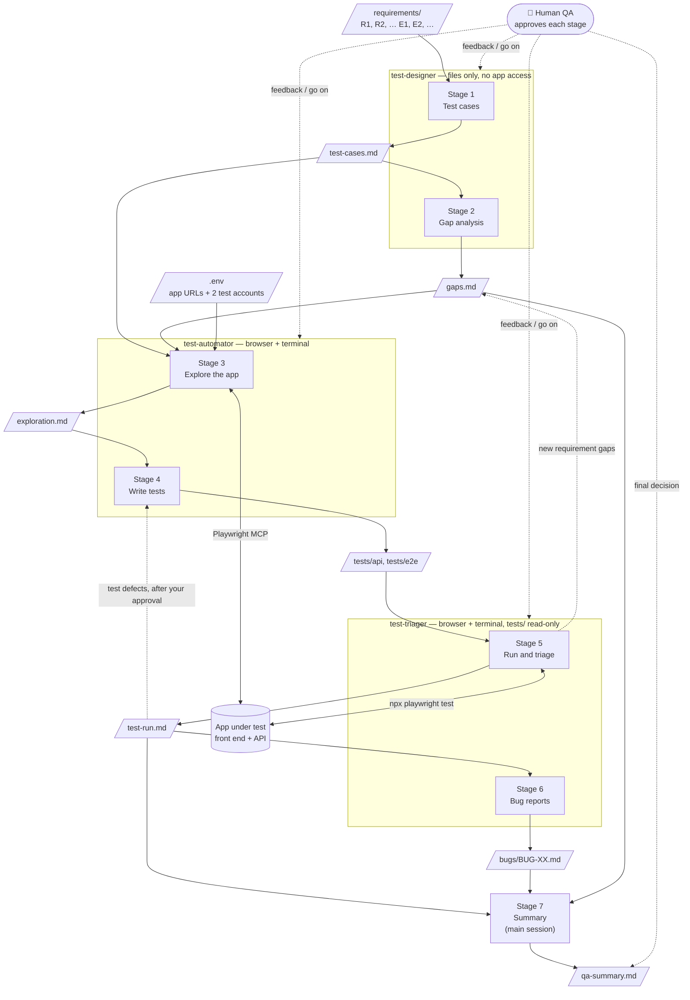
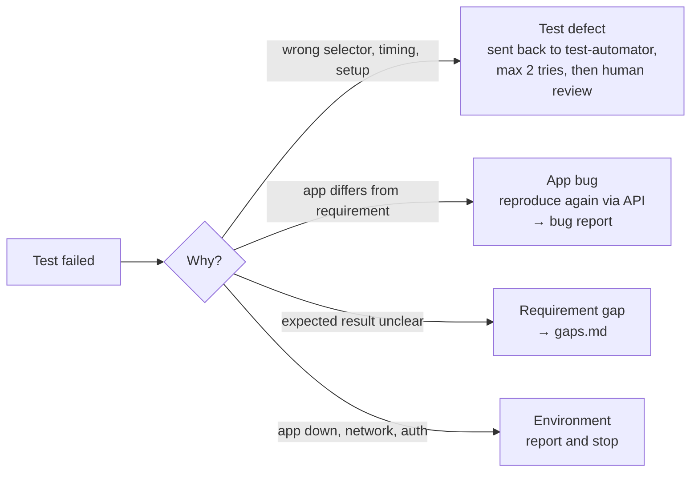

# QA Agent

A QA framework that runs in [Claude Code](https://claude.com/claude-code). You give it product requirements. It writes test cases and a gap analysis, then explores the app, writes and runs automated tests, and writes bug reports and a release summary.

Three agents do the work:

| Agent | Stages | Tools | Why it is separate |
|---|---|---|---|
| `test-designer` | 1–2 | Read and write files only | It designs tests from the requirements only, before anyone sees the app. So the app's current behavior cannot become the expected result. |
| `test-automator` | 3–4 | Browser (Playwright MCP) and terminal | It explores the app and writes the tests. It cannot change the expected results. It does not judge test failures. |
| `test-triager` | 5–6 | Browser (Playwright MCP) and terminal. It can read `tests/` and `pages/`, but a hook blocks every write there. | It runs the tests, decides why each test failed and writes the bug reports. It did not write the tests and cannot change them. So nobody can turn an app bug into a passing test without you seeing it. |

The main Claude Code session runs the stages in order and writes the summary (Stage 7). After each stage it stops and waits for your approval.

## The flow in short

1. **test-designer** (sees only the requirements, not the app)
   - Stage 1: writes test cases from `requirements/`.
   - Stage 2: writes the gap analysis, the open questions about the requirements.
2. **test-automator** (browser and terminal)
   - Stage 3: explores the app (routes, API calls, selectors).
   - Stage 4: writes the automated tests (mostly API, a few E2E).
3. **test-triager** (runs the tests but cannot change them, because a hook blocks this)
   - Stage 5: runs the tests and decides why each test failed:
     - **App bug** → goes to Stage 6.
     - **Test defect** → sent back to the test-automator, after your approval. Then Stage 5 runs again.
     - **Unclear requirement** → added to `gaps.md`.
     - **Environment problem** → it stops and reports.
   - Stage 6: writes bug reports. If the bug already exists, it updates that report.
4. **Main session**
   - Stage 7: writes the QA summary: results, coverage, bugs, gaps and top risks.

**The main idea:** no agent checks its own work. The test-designer agent decides the correct results before anyone sees the app. The test-triager agent decides why a test failed, but it did not write the tests.

## How it works



How each failure in Stage 5 is handled:



## Pipeline

| Stage | Owner | Output |
|---|---|---|
| 1. Test cases | test-designer | `test-cases/test-cases.md` |
| 2. Gap analysis | test-designer | `reports/gaps.md` |
| 3. Explore the app | test-automator | `reports/exploration.md` |
| 4. Automated tests | test-automator | `tests/`, `pages/` |
| 5. Run and triage | test-triager | `reports/test-run.md` |
| 6. Bug reports | test-triager | `bugs/BUG-XX.md` |
| 7. Summary | main session | `reports/qa-summary.md` |

## Setup

Requirements: Node.js 20.6 or newer, and Claude Code.

```bash
npm install
npx playwright install chromium
cp .env.example .env    # then fill in the values
```

`.env` values:

| Key | Meaning |
|---|---|
| `BASE_URL` | The app's front end (used by E2E tests) |
| `API_BASE_URL` | The app's API (used by API tests) |
| `OWNER_EMAIL`, `OWNER_PASSWORD` | Test account 1 |
| `SHARED_EMAIL`, `SHARED_PASSWORD` | Test account 2 |

Use test accounts only. `.env` is never committed.

Start Claude Code in this folder. When it asks, approve the `playwright` MCP server from `.mcp.json`. The browser runs headless.

## How to use

1. Put the requirements in `requirements/` (`.md`, `.pdf` or `.txt`). Number them R1, R2, … and named edge cases E1, E2, …. If they are not numbered, the test-designer numbers them.
2. In Claude Code, say **"run Stage 1"**.
3. Read the result. Give feedback, or say **"go on"** for the next stage.
4. If Stage 5 sends test defects back, approve them. The test-automator fixes the tests, and the test-triager runs Stage 5 again.

## Run the tests

```bash
npm test                          # all tests
npx playwright test --project=api # API tests only
npx playwright test --project=e2e # browser tests only
npx playwright test --grep @P1    # P1 tests only
npm run report                    # open the HTML report
```

## Project structure

```
├── CLAUDE.md                 # shared rules: priorities, formats, writing style
├── .claude/agents/           # test-designer.md, test-automator.md, test-triager.md
├── .claude/hooks/            # block-test-edits.mjs: stops the triager from changing tests
├── .mcp.json                 # Playwright MCP (headless, Chromium)
├── requirements/             # input: product requirements
├── test-cases/               # Stage 1
├── reports/                  # Stages 2, 3, 5, 7
├── bugs/                     # Stage 6
├── tests/
│   ├── api/                  # API tests (most tests)
│   ├── e2e/                  # browser tests (only browser-only behavior)
│   └── helpers/              # env, API client, fixtures, secret redaction
├── pages/                    # Page Objects for E2E tests
└── playwright.config.ts      # "api" and "e2e" projects
```

## Main rules

- **Nobody judges their own work.** The designer writes the expected results before anyone sees the app. The triager judges the tests, but it cannot edit them. A hook lets it write only its own outputs (`reports/test-run.md`, `reports/gaps.md`, `bugs/`). So it cannot change the tests, the test cases, the test config or the hook itself. The hook checks file tools exactly. For shell commands it checks common patterns only, so it is a strong guard, not a full sandbox. Claude Code runs the hook only after you trust this folder (the trust prompt when you first open it).
- **Risk first.** P1 means access control, security or data loss only. Most tests are API tests. E2E tests check only what needs a real browser.
- **Two accounts.** Every permission test checks both users, plus a request with no login.
- **No guessing.** Assumptions are marked [A] and get a question in the gap analysis. The app's behavior never becomes the expected result.
- **No secrets in output.** Traces and videos are off, because they would record passwords and tokens. Errors from the API client are redacted. Each stage scans its output for credentials.
- **Account safety.** Tests send at most 1 wrong password per real account per run, so the accounts do not get locked. To allow more, set `QA_ALLOW_REAL_ACCOUNT_WRONG_PASSWORDS=1`. Do this only if lockout is safe in your test environment.

## Current state (demo)

The demo runs against a sample "virtual data room" app, with one requirement: R1, email/password login.

- 26 test cases. 22 automated tests: 17 passed, 2 failed, 3 skipped.
- 2 bugs: BUG-01 (High, logout does not end the session on the server) and BUG-02 (Medium, no limit on failed logins).
- 24 open gaps.

See [`reports/qa-summary.md`](reports/qa-summary.md).
